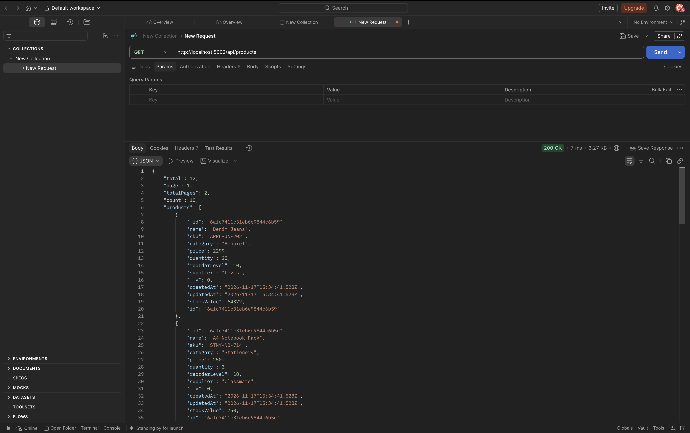
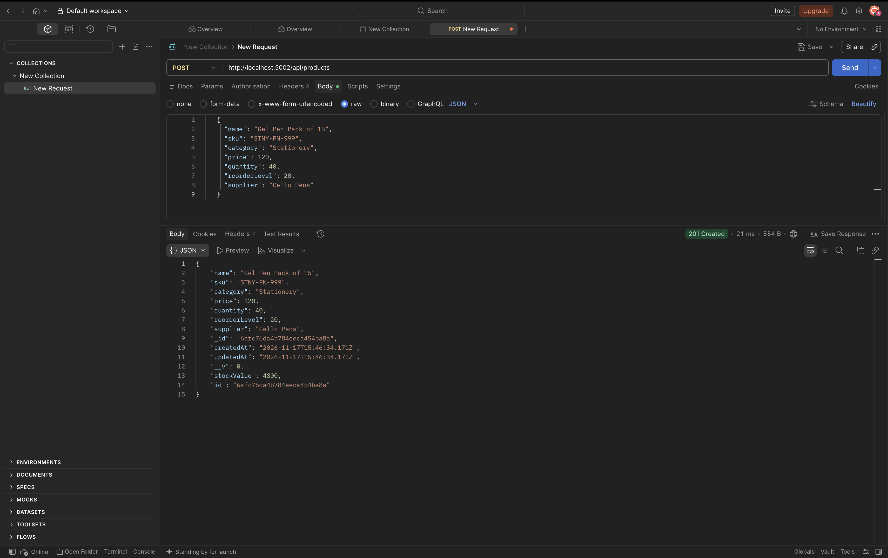
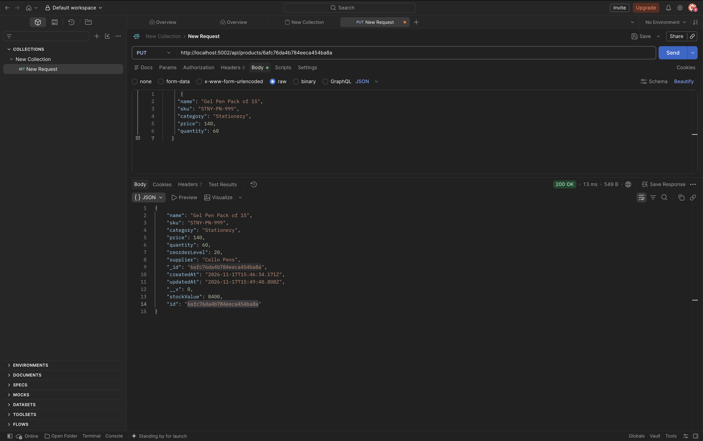
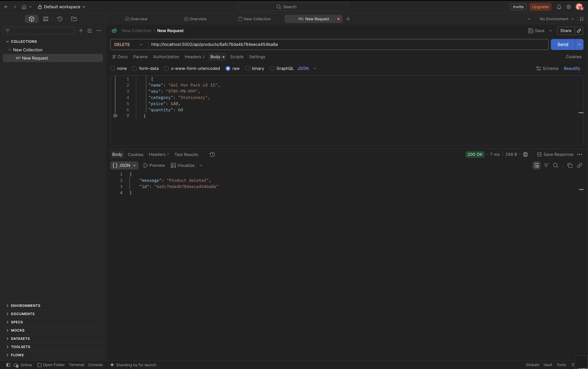
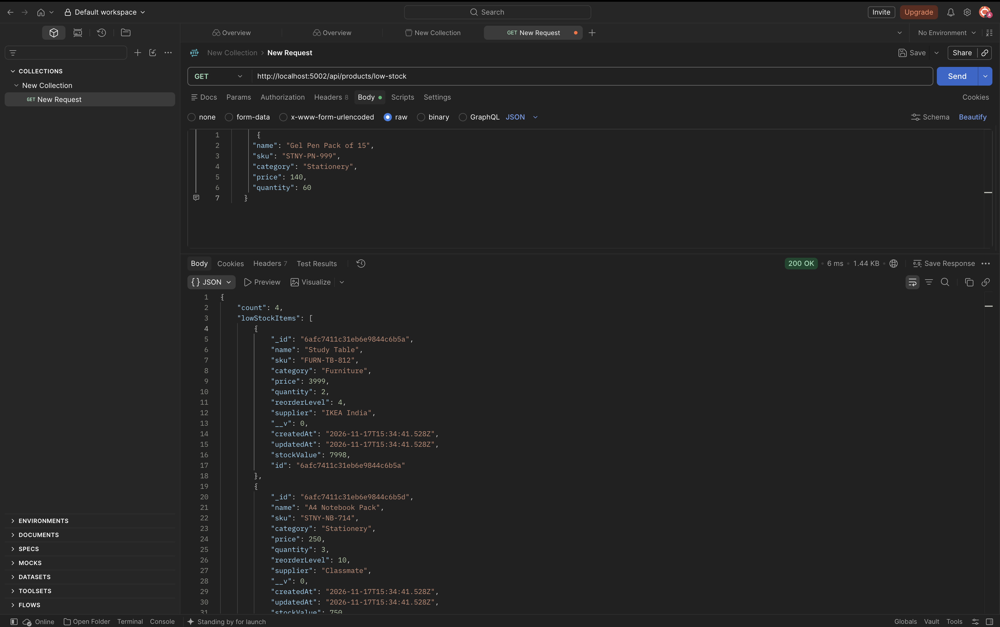
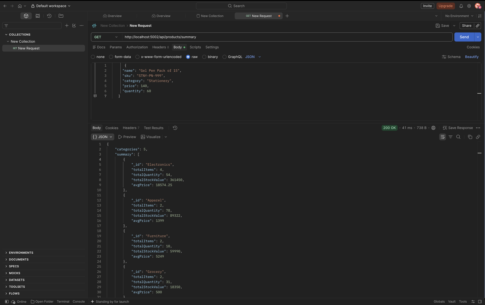
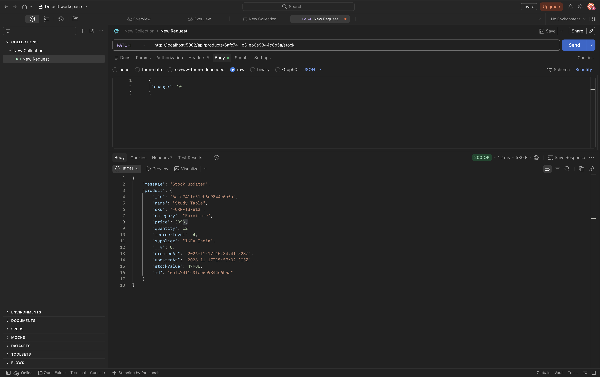

# Inventory and Data Management System

Web Dev III - Assignment 3

A simple backend API to manage products of a store/warehouse. Made using Node.js, Express, MongoDB (Mongoose) and dotenv.

## How to run

```
npm install
npm run seed     (optional, adds 12 sample products)
npm start
```

Create a `.env` file:

```
PORT=5002
MONGO_URI=mongodb://127.0.0.1:27017/inventory_db
```

Server runs on `http://localhost:5002`

## Product fields

name, sku (unique), category, price, quantity, reorderLevel, supplier.
Validation is done in the Mongoose schema (required fields, price/quantity cannot be negative). `stockValue` (price x quantity) is added automatically.

## APIs

| Method | Endpoint | Work |
|---|---|---|
| POST | /api/products | create product |
| GET | /api/products | get all (filter, sort, pagination) |
| GET | /api/products/:id | get one product |
| PUT | /api/products/:id | update product |
| PATCH | /api/products/:id/stock | restock / sale, body: `{"change": 10}` or `{"change": -3}` |
| DELETE | /api/products/:id | delete product |
| GET | /api/products/low-stock | products with quantity <= reorderLevel |
| GET | /api/products/summary | category-wise summary |

Query params for get all: `category`, `search`, `minPrice`, `maxPrice`, `sort` (like `-price`), `page`, `limit`

Example: `/api/products?category=Electronics&sort=-price&page=1&limit=5`

## Screenshots (Postman)

### 1. Get All Products - `GET /api/products`
Returns all products with pagination (total 12, page 1, 10 products per page).



### 2. Create Product - `POST /api/products`
Creates a new product. Response is `201 Created`.



### 3. Update Product - `PUT /api/products/:id`
Updates price and quantity of the product created above. Response is `200 OK`.



### 4. Delete Product - `DELETE /api/products/:id`
Deletes the product using its id.



### 5. Low-Stock Alert Report - `GET /api/products/low-stock`
Shows the products whose quantity is less than or equal to the reorder level (count: 4).



### 6. Category-wise Inventory Summary - `GET /api/products/summary`
Aggregation result with total items, total quantity, total stock value and average price for each category (5 categories).



### 7. Stock Adjustment - `PATCH /api/products/:id/stock`
Adds 10 to the stock of Study Table (quantity 2 became 12).



## Notes

- Low-stock and summary use MongoDB aggregation.
- Stock can never go below 0 (a sale with not enough stock gives 400 error).
- All errors are handled in one place (`middleware/errorHandler.js`).
